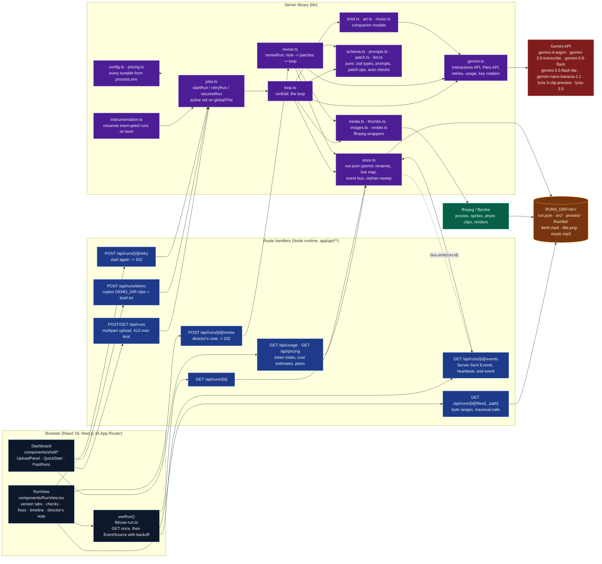
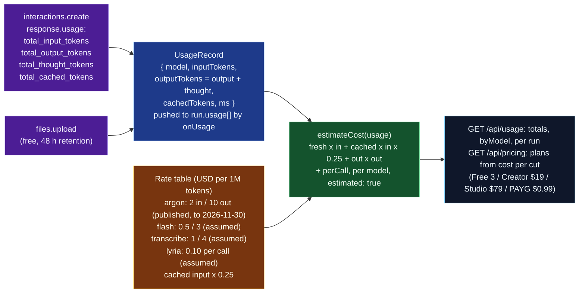

# PolishedTake

Every cut gets a polished take: the editor watches its own render and fixes it before you see it.

Raw footage plus a one-line brief in, a finished cut out, with the receipts. Gemini 4 Argon watches
every clip, writes an edit decision list (EDL), ffmpeg renders it, then Argon **watches its own
render**, grades it with timestamped pass/fail checks, patches the EDL and re-renders. Up to three
versions, or until every check passes. You see v1, v2, v3 side by side with the critique behind each
change, streamed live, and you decide what to export.

Built for the Gemini 4 Argon SF Hackathon (Problem Statement Two: More Dimensions). Everything in
this repo was written on the day; see the last section.

## Who this is for

Ankit, the builder, shot the hackathon day on his phone and wants a recap cut by the time demos
start. He has footage, a sentence describing the cut he wants, and no editor. That is the test case
in this repo, and it stands in for every creator with the same problem: the footage exists, the
edit does not, and the hard part is not the cutting but checking the cut (did it land on a word
boundary, are the captions in sync, did it actually cover what I asked for).

## Why Argon

How the project maps to the four things judges score.

**1. A specific problem for a real person.** A phone-shot recap of today, cut to a brief, before the
demo. The brief is free text (`"30s recap with captions. Open on the strongest moment, end on a clear
beat."`), and the critique turns every line of it into a named check (`brief: open on the welcome`)
that must pass.

**2. Work that needed Gemini 4 Argon.** Two calls per version carry the load, both on
`gemini-4-argon` with `thinking_level: medium`:

- *Draft* sees every source clip as video plus a word-timed transcript of each, in one context, and
  returns a schema-checked EDL: which source ranges, in what order, with captions whose times are on
  the output timeline.
- *Critique* watches the rendered mp4, not the EDL, and returns checks with `at` in output-timeline
  seconds, plus patch operations that reference specific cut ids (`trim c2 srcIn 40.5`). The render
  is the ground truth: mid-word cuts, caption drift and jump cuts only exist once ffmpeg has made the
  file.

That is an autonomous verification loop over video, and it is agentic in the useful sense: the model
inspects an artifact it produced indirectly, localizes what is wrong, and emits a precise fix rather
than a rewrite.

**3. People stay in control.** Nothing is published, posted or paid for. The loop produces files in a
local `runs/` directory and stops at three versions. Every patch is shown before and after in the
Fixes tab; skipped or clamped patches are listed as warnings. Export is a manual download of the
version you pick. A director's note (`POST /api/runs/:id/revise`) lets you steer the next version
instead of re-running from scratch. Model calls use `store: false`, so interactions are not retained
on the server.

**4. Runs live with real inputs in under three minutes.** Drop clips, type a brief, press Cut it. The
run page streams progress over Server-Sent Events: transcribe, draft, render, watch, fix. Measured on
this laptop today with the three bundled demo clips: run `25fcb3b90b` reached v1 at 63 s and finished
two versions in **88 s**; run `444174c5ce` finished two versions in **133 s** (stage timings are stored
on every run as `run.timings`). The demo script in `docs/DEMO.md` opens a finished run while the live
one cooks.

## The loop in 60 seconds

```
   phone footage (mp4/mov/webm/mkv, photos) + a one-line brief
                        |
                        v
   +-------------------------------+   ffprobe, ffmpeg
   | probe, 480p proxies, thumbs   |
   +---------------+---------------+
                   | upload proxies (Files API, cached by sha256)
                   v
   +-------------------------------+   gemini-3.5-transcribe
   | transcribe: word timestamps   |   (falls back to gemini-3.8-flash)
   +---------------+---------------+
                   v
   +-------------------------------+   gemini-3.5-flash-lite (optional, never fatal)
   | analyze brief: target length, |   hints are appended to the brief Argon drafts from
   | tone, captions?, music mood   |
   +---------------+---------------+
                   v
   +-------------------------------+   gemini-4-argon, thinking medium, store:false
   | draft: EDL as JSON that must  |   input: every clip as video + every transcript + brief
   | validate (cuts, captions,     |   output: {title, cuts[{clipId, srcIn, srcOut, reason}],
   | title, music prompt)          |            captions[{text, start, end}], music?{prompt}}
   +---------------+---------------+
                   v
          +-----------------+         title.png: gemini-nano-banana-2.1 (once per run)
    +---->| assets + render |         music.mp3: lyria-3-clip-preview / lyria-3.5, looped + ducked
    |     +--------+--------+         iterN.mp4 (ffmpeg): 1280x720 @ 30fps, 2s title card,
    |              v                  burned-in captions, h264/aac
    |     +---------------------------+   gemini-4-argon watches iterN.mp4
    |     | critique: checks + patches|   one check per line of the brief, plus
    |     | {name, passed, at, note}  |   caption sync, mid-word cuts, jump cuts,
    |     +--------+------------------+   duration, title legibility
    |              v
    |     +---------------------------+   lib/lint.ts, pure and deterministic
    |     | auto checks from the      |   mid-word cuts, captions vs spoken words,
    |     | transcripts               |   duration vs brief, cuts inside clip bounds
    |     +--------+------------------+
    |              v
    |      every check passed?  -- yes -->  done: v1..vN side by side, export the one you want
    |              | no
    |              v
    |     +---------------------------+   trim | remove_cut | insert_cut | move_cut | set_caption |
    +-----| apply patches to the EDL  |   add_caption | remove_caption | set_title | set_music
          +---------------------------+   pure function; bad ops are skipped and reported,
          at most 3 versions               cuts clamped to clip bounds, <0.3s cuts dropped
```

Each model call asks for JSON against a schema derived from the zod types in `lib/schema.ts`. If the
reply does not validate, the validation error is fed back once and the model answers again.

## How we use the Gemini 4 Argon toolkit

Everything below is read from the code, not from a plan. File references are exact; model ids are
the defaults in `lib/config.ts`, `lib/brief.ts`, `lib/art.ts` and `lib/music.ts` and can be changed
from the environment (see `.env.example`).

### The self-correcting loop

```mermaid
flowchart TD
    classDef input fill:#1f2937,stroke:#9ca3af,color:#f9fafb
    classDef ffmpeg fill:#065f46,stroke:#34d399,color:#ecfdf5
    classDef argon fill:#4c1d95,stroke:#c4b5fd,color:#f5f3ff,stroke-width:2px
    classDef companion fill:#1e3a8a,stroke:#93c5fd,color:#eff6ff
    classDef fallback fill:#78350f,stroke:#fbbf24,color:#fffbeb,stroke-dasharray:5 3
    classDef pure fill:#7c2d12,stroke:#fdba74,color:#fff7ed
    classDef decision fill:#111827,stroke:#f472b6,color:#fdf2f8
    classDef done fill:#14532d,stroke:#86efac,color:#f0fdf4,stroke-width:2px

    IN["Footage + brief<br/>POST /api/runs (multipart, &le; MAX_UPLOAD_BYTES)"]:::input
    PREP["Prepare<br/>ffprobe duration &middot; 480p h264 proxy &middot; 160x90 thumbnail sprite<br/>lib/media.ts &middot; lib/thumbs.ts (3 clips at a time)"]:::ffmpeg
    UP["Files API upload<br/>sha256-cached in runs/.upload_cache.json<br/>poll every 3 s until ACTIVE &middot; lib/gemini.ts"]:::companion
    TR["Transcribe<br/>gemini-3.5-transcribe<br/>word timestamps as JSON, all clips in parallel"]:::companion
    TRF["Fallback<br/>gemini-3.8-flash<br/>same prompt, same schema"]:::fallback
    AN["Analyze brief<br/>gemini-3.5-flash-lite<br/>target seconds, tone, captions?, music mood<br/>lib/brief.ts (optional)"]:::companion
    DR["Draft EDL<br/>gemini-4-argon &middot; thinking_level: medium &middot; store: false<br/>input: every clip as video + every transcript + brief<br/>output: JSON validated by zod EdlDraftSchema"]:::argon
    ART["Title-card art<br/>gemini-nano-banana-2.1<br/>response_format image 16:9 1K &middot; once per run &middot; lib/art.ts"]:::companion
    MUS["Music bed<br/>lyria-3-clip-preview (&le; 30 s) / lyria-3.5<br/>response_format audio &middot; looped with acrossfade &middot; lib/music.ts"]:::companion
    REN["Render iterN.mp4<br/>ffmpeg concat &middot; drawtext captions &middot; title plate<br/>music ducked under dialogue, -14 LUFS &middot; lib/render.ts"]:::ffmpeg
    CR["Watch and critique<br/>gemini-4-argon &middot; thinking_level: medium &middot; store: false<br/>input: the rendered mp4 (Files API) + EDL + computed timeline<br/>output: checks[{name, passed, at, note}] + patches[]"]:::argon
    LINT["Deterministic lint<br/>lib/lint.ts: no mid-word cuts &middot; captions match speech<br/>duration matches brief &middot; cuts inside clip bounds"]:::pure
    Q{"every check<br/>passed?"}:::decision
    PATCH["Apply patches<br/>sanitizePatches drops leaked reasoning<br/>Argon's ops first, lint ops last &middot; lib/patch.ts (pure)"]:::pure
    DONE["Done: v1..vN side by side<br/>SSE stream closes &middot; export the version you pick"]:::done

    IN --> PREP --> UP --> TR
    TR -. "any error" .-> TRF
    TR --> AN --> DR
    TRF --> AN
    DR --> ART --> MUS --> REN --> CR --> LINT --> Q
    Q -- "no, n < MAX_ITERATIONS" --> PATCH --> REN
    Q -- "yes, or n = MAX_ITERATIONS (3)" --> DONE
```



Purple is Argon (the two calls that need it), blue is a companion Gemini model, green is local
ffmpeg, orange is pure TypeScript with no I/O. Dashed amber is the fallback path. The companion
stages (analyze, art, music) are wrapped in `optional()` in `lib/loop.ts`: a failure becomes a warning
on the run and the cut continues without that asset.

### One iteration, call by call

What actually crosses the wire for one render -> watch -> fix round. Every Interactions request is
built in `call()` in `lib/gemini.ts` and sent through `withRetry()`.

```mermaid
sequenceDiagram
    autonumber
    participant L as lib/loop.ts
    participant F as ffmpeg
    participant G as lib/gemini.ts
    participant FA as Gemini Files API
    participant A as gemini-4-argon
    participant LT as lib/lint.ts
    participant P as lib/patch.ts

    rect rgb(6, 95, 70)
        L->>F: renderEdl(edl, clipFiles, iterN.mp4, {music, titleImage})
        F-->>L: iterN.mp4 (h264/aac, 1280x720@30)
    end
    rect rgb(76, 29, 149)
        L->>G: critique(brief, edl, iterN.mp4, clips)
        G->>G: sha256(iterN.mp4) -> cache miss
        G->>FA: files.upload(mp4)  [withRetry: 4 attempts, 0.5 s -> 4 s + jitter]
        loop every 3 s until ACTIVE (deadline LLM_TIMEOUT_MS)
            G->>FA: files.get(name)
        end
        G->>A: interactions.create({ model, input: [video, prompt], store: false,<br/>generation_config: { thinking_level: "medium" },<br/>response_format: { type: "text", mime_type: "application/json", schema } })
        A-->>G: output_text (JSON) + usage { input, output, thought, cached tokens }
        G->>G: CritiqueSchema.safeParse
        alt invalid JSON
            G->>A: same parts + "It failed validation: ..." (one retry)
            A-->>G: corrected JSON
        end
        G-->>L: Critique { checks, patches, summary } + onUsage(UsageRecord)
    end
    rect rgb(124, 45, 18)
        L->>LT: lintEdl(edl, clips, brief)
        LT-->>L: 4 "auto:" checks + deterministic patches
        L->>L: mergeCritique(argon, auto) -> saved on iteration N, streamed over SSE
        alt every check passed, or N = MAX_ITERATIONS
            L-->>L: status "done"
        else
            L->>L: sanitizePatches(argon.patches)
            L->>P: applyPatches(edl, argonPatches)
            L->>LT: lintEdl(patched) -> fresh auto patches
            L->>P: applyPatches(patched, autoPatches)
            P-->>L: EDL for iteration N+1 (skipped ops -> run.warnings)
        end
    end
```



Why the lint runs twice: Argon's patches can move a cut onto a new word boundary, so the
deterministic fixes are recomputed on the patched EDL and applied last. A transcript-backed caption
correction therefore always wins over a model rewrite (`lib/loop.ts`, `lib/revise.ts`).

### Where everything lives



### What a cut costs

The Gemini API reports tokens, not money, so every dollar figure in the app is an estimate: token
counts from each response times a rate table (`lib/pricing.ts`). Only Argon's hackathon rate is
published; the rest are assumptions you can override with `PRICE_*` variables.



Thinking tokens are billed as output, so `outputTokens` folds `total_thought_tokens` in. A `402`
from the API is surfaced as `CreditsExhaustedError` and never retried; the remaining balance is only
visible at AI Studio billing, which the usage page links to.

### Hackathon guide, item by item

| Guide item | Where it lives | What the code does |
|---|---|---|
| `thinking_level` | `lib/gemini.ts` `call()`; `draft()` and `critique()` pass `"medium"` | Both Argon calls send `generation_config: { thinking_level: "medium" }`. Transcription and the companion models send none. |
| Long (1M) context | `lib/gemini.ts` `draft()`; `lib/prompts.ts` `draftPrompt()` | One request carries every source clip as a video part, every word-timed transcript and the brief; the critique carries the rendered mp4, the full EDL and the computed timeline. No chunking, no summaries. |
| `store: false` | `lib/gemini.ts` `call()`, `lib/brief.ts`, `lib/art.ts` | Every `interactions.create` is sent with `store: false`; nothing is retained server-side. Lyria calls in `lib/music.ts` do not set it (audio generation, no conversation state). |
| Retries and timeouts | `lib/gemini.ts` `withRetry()`, `isRetryable()`, `LLM_TIMEOUT_MS` | 4 attempts, 0.5 s -> 4 s exponential backoff with +/-20% jitter, on 429/5xx, transport errors and empty replies; 400/401/403 and 402 (credits) never retried. The SDK gets `httpOptions.timeout = LLM_TIMEOUT_MS` (15 min); Files API polling has the same deadline. |
| Structured output | `lib/gemini.ts` `responseSchema()`, `askJson()`; `lib/schema.ts` | JSON Schema is derived from the zod types with `z.toJSONSchema`, sent as `response_format`, validated on return; one repair round feeds the validation error back. Falls back to a plain prompt if the server rejects the schema. |
| Files API | `lib/gemini.ts` `uploadVideo()` | 480p proxies and renders are uploaded, cached by sha256 in `RUNS_DIR/.upload_cache.json`, deduplicated in flight, polled until `ACTIVE`; a stale cache entry is re-uploaded. |
| Companion models | `lib/brief.ts`, `lib/art.ts`, `lib/music.ts`; wired in `lib/loop.ts` `optional()` | `gemini-3.5-flash-lite` reads the brief; `gemini-nano-banana-2.1` paints the title plate (`response_format: { type: "image" }`); `lyria-3-clip-preview` / `lyria-3.5` generate the bed (`response_format: { type: "audio" }`). Each is optional and degrades to a warning. |
| Model fallback | `lib/gemini.ts` `transcribe()` | `gemini-3.5-transcribe` first, `gemini-3.8-flash` on any error, same prompt and schema. |
| Verification loop | `lib/loop.ts` `runEdit()`; `lib/lint.ts`; `lib/patch.ts` | Render, watch, grade, patch, repeat to `MAX_ITERATIONS` (3). Argon's judgement is cross-checked by four deterministic transcript checks; patches are pure, clamped and reported. |
| Human in control | `app/api/runs/[id]/revise`, `lib/revise.ts`; `app/api/runs/[id]/retry`; `components/RunView.tsx` | A director's note becomes the brief for the next version, applied to the current cut (not a restart), with the same sanitize + lint discipline. Export is a manual download. Nothing is published. |
| Resilience | `instrumentation.ts`, `lib/jobs.ts` `resumeInterruptedRuns()`, `lib/store.ts` orphan sweep | Runs interrupted by a server restart are resumed on boot (transcripts reused); a run with no loop behind it is marked as an error after 90 s instead of spinning forever. |
| Cost awareness | `lib/gemini.ts` `onUsage`, `lib/pricing.ts`, `app/api/usage`, `app/api/pricing` | Every call's token usage is recorded on the run; totals, per-model and per-run estimates and sellable plans are served, always flagged `estimated: true`. |
| Live demo under 3 minutes | `docs/DEMO.md`; `run.timings` on every run | Measured today: 88 s (run `25fcb3b90b`, v1 at 63 s) and 133 s (run `444174c5ce`), both two-version cuts of the bundled demo clips. The script shows a finished run while the live one cooks. |
| Generated B-roll (module only) | `lib/broll.ts` | `gemini-omni-1.1-flash` text/image-to-video with `response_format: { type: "video" }`, normalised to the output frame. Landed today as a module with its own tests; `lib/loop.ts` does not call it yet, so it is not in the diagrams above. |
| Nothing hard-coded | `lib/config.ts`, `lib/pricing.ts`, `.env.example` | Model ids, paths, limits, output size, iteration counts, upload cap, prices and the demo brief (`DEMO_BRIEF` or `footage/demo/brief.txt`) all come from the environment with validated defaults. |

## What you see

- **Version tabs** `v1 7/11`, `v2 11/11`: a dot per version (red failing, green passing) and the
  check score. Click to compare renders.
- **Checks tab**, grouped into *Your brief*, *Verified* (the deterministic transcript checks) and
  *Craft*. Every failing check with a timestamp has a play button; clicking it seeks the viewer to
  that second.
- **Timeline** with V1 (filmstrip of the actual frames), C1 (captions) and a QA track where each
  failure sits as a red mark at its output time. The scrub bar repeats those marks as red ticks.
- **Fixes tab**: each patch in words, with the before and after values, and whether it was applied
  to make the next version or proposed when the loop stopped.
- **Edit list tab**: the raw EDL, cut by cut, with Argon's reason for each cut.
- **Director's note** under the inspector on a finished run: one sentence, and Argon re-cuts from
  this version and checks the result again.
- **Past cuts** in the sidebar, the `/how` page that explains each stage using your latest finished
  run, and a loop of the latest final render on the home page.

## Honest limits

- Hard cuts only. No transitions or colour work. Captions are ffmpeg `drawtext`, white on a
  translucent box, one style. The music bed is one generated instrumental, looped and ducked.
- The critique is a model judgment. It can pass something a human would fail and vice versa. The
  deterministic checks in `lib/lint.ts` only cover what can be computed from the transcripts (cuts
  inside a word, captions whose text does not match the words spoken, duration, clip bounds).
- Three versions, then it stops. If Argon reports failures but no patches, it stops early and says so
  in the warnings.
- Latency scales with footage. Each version is a render, an upload of that render and one Argon call
  over it. Long source clips mean long transcripts in the prompt.
- 480p proxies and 720p renders are uploaded through the Files API so the model can watch them; the
  originals never leave the machine. Interactions are sent with `store: false`. Uploads are not
  deleted by the app.
- Single machine, no accounts, no auth. `runs/` is a directory, not a database. The upload cap
  (`MAX_UPLOAD_BYTES`, 2 GiB) is the only quota.
- Costs are estimates from token counts; the API does not report charges.
- Fonts are looked up from a short list of macOS and Debian paths; on another system the title and
  captions fall back to ffmpeg's default font.

## Stack

- Next.js 16 (App Router, React 19), TypeScript, zod
- `@google/genai` Interactions API: `gemini-4-argon` (draft, critique, patch), `gemini-3.5-transcribe`
  (transcripts, falls back to `gemini-3.8-flash`), `gemini-3.5-flash-lite` (brief analysis),
  `gemini-nano-banana-2.1` (title art), `lyria-3-clip-preview` / `lyria-3.5` (music bed)
- ffmpeg / ffprobe for proxies, thumbnails, photo clips, music looping and rendering
- Optional Remotion player preview

## Setup

Requires Node 22 and ffmpeg on your PATH.

```
npm install
cp .env.example .env   # set GEMINI_API_KEY; every other variable is optional and documented there
npm run dev            # open http://localhost:3000
```

Headless, without the UI:

```
npx tsx scripts/cut.ts --brief "30s recap with captions" clip1.mp4 clip2.mp4
npx tsx scripts/check-gemini.ts [clip.mp4]   # live smoke test of the model wiring
```

## Tests

```
npm test               # vitest, no API key or network needed
npm run typecheck
npm run lint
```

Route handlers are tested directly with Fetch `Request` objects (`tests/api-routes.test.ts`); the
loop, revisions and renders run against tiny real mp4s generated by ffmpeg. `tests/live.test.ts`
hits Gemini and skips itself unless `GEMINI_API_KEY` is set.

## Architecture

- `lib/loop.ts`: prepare, transcribe, analyze, draft, (assets, render, critique, lint, patch) loop (`runEdit`)
- `lib/revise.ts`: director's note applied to the last cut, then the same loop (`reviseRun`)
- `lib/gemini.ts`: Gemini client, Files API uploads, structured JSON output, retries, usage, key rotation
- `lib/brief.ts`, `lib/art.ts`, `lib/music.ts`: the companion models, each optional
- `lib/render.ts`: EDL to mp4 via ffmpeg (`renderEdl`)
- `lib/patch.ts`: applies critique patch ops to the EDL (`applyPatches`)
- `lib/lint.ts`: deterministic checks from the transcripts (`lintEdl`)
- `lib/schema.ts`, `lib/prompts.ts`, `lib/media.ts`, `lib/thumbs.ts`, `lib/images.ts`, `lib/store.ts`,
  `lib/jobs.ts`, `lib/config.ts`, `lib/pricing.ts`: types, prompts, ffmpeg helpers, run persistence,
  background jobs, configuration, cost model
- API routes: `POST/GET /api/runs`, `GET/POST /api/runs/demo`, `GET /api/runs/[id]`,
  `GET /api/runs/[id]/events` (Server-Sent Events), `GET /api/runs/[id]/files/[...path]` (renders,
  proxies, sprites, art, music; byte ranges), `POST /api/runs/[id]/revise`, `POST /api/runs/[id]/retry`,
  `GET /api/usage`, `GET /api/pricing`
- `AGENTS.md`: the quirks and lessons for anyone (human or agent) working in this repo

## Privacy

Every Gemini call is sent with `store: false`, so interactions are not retained server-side. Footage
and renders stay in the local `runs/` directory; only the 480p proxies and the rendered versions are
uploaded for the model to watch.

## Legacy Python version

The original FastAPI/Python editor lives in `editor/` and `web/` (with `tests/*.py`). It is kept for
reference; the Next.js app is the supported path.

## Built during the hackathon (Oct 25, 2026)

Everything in this repository was written today, starting from an empty folder. No code was
carried over from other projects.

## More docs

- `docs/DEMO.md` — the 3-minute live demo script with fallbacks
- `docs/PITCH.md` — the 90-second pitch and likely judge questions
- `docs/PRODUCTION-READINESS.md` — an honest review of what must change before charging customers
- `docs/SCALING.md` — any-footage handling and the Files API lifecycle (upload → use → delete)
- `docs/LIVE.md` — the Gemini Live voice assistant and its ephemeral-token flow
- `AGENTS.md` — codebase quirks and lessons for anyone (human or agent) working here
